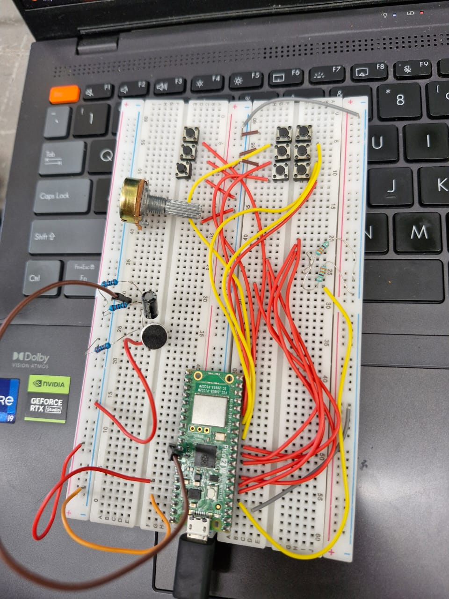
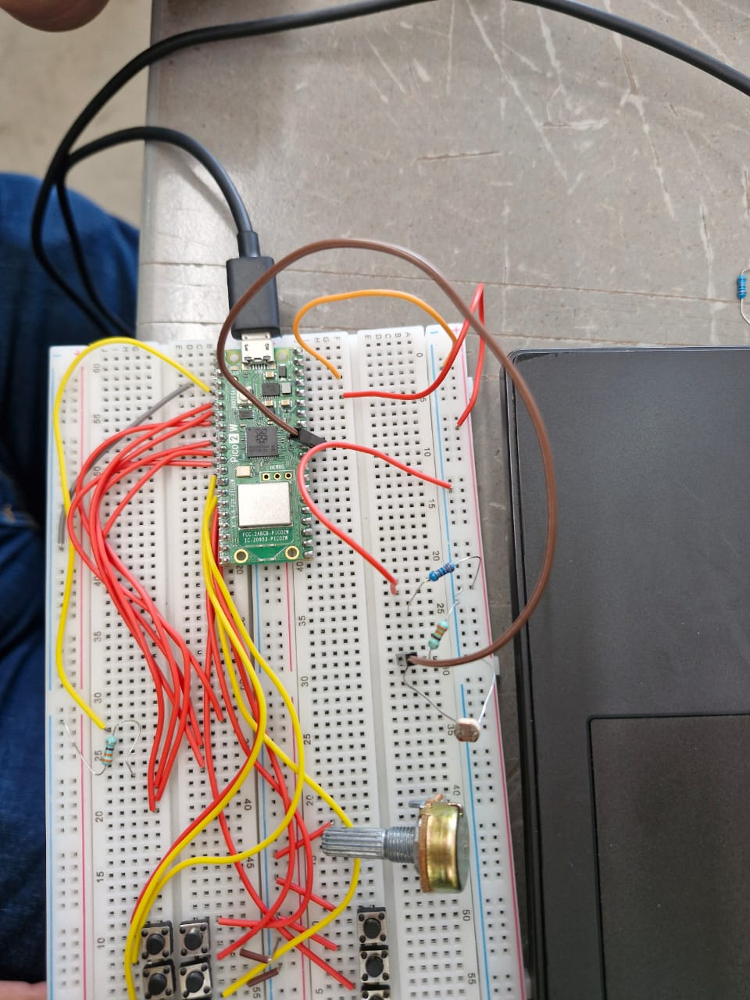

# Analog Sensors with ADC and UART (RP2350)

## Objective

Use the RP2350's 12-bit ADC to read four different analog sensors and turn the raw readings into physical quantities: temperature, rotation angle, sound level and light intensity. Some activities also send the converted value through the hardware UART, in addition to the USB serial monitor, so the data can be read by an external device.

## Materials and Components

- 1 × Raspberry Pi Pico 2 W
- 1 × LM35 temperature sensor
- 1 × Potentiometer
- 1 × Microphone module with analog output
- 1 × Light sensor *(complete)*
- 1 × USB-to-TTL serial adapter (to read the UART output)
- 1 × Protoboard
- Male-to-male jumper wires
- Micro-USB cable (programming and power)

## ADC basics on the RP2350

The ADC has a 12-bit resolution, so `adc_read()` returns a value between 0 and 4095, where 0 corresponds to 0 V and 4095 to the 3.3 V reference. Every activity uses the same conversion to get back to volts:

```
V = lectura × 3.3 / 4095
```

The analog-capable pins are GPIO26 (ADC0), GPIO27 (ADC1) and GPIO28 (ADC2). Each one has to be prepared with `adc_gpio_init()`, which disconnects the digital logic from the pin, and then selected with `adc_select_input()`, since the ADC can only convert one channel at a time.

---

## Activity 1 — Temperature sensor (LM35)

### Circuit Diagram

```
LM35 Vs   → VBUS (5 V)
LM35 Vout → GPIO26 (ADC0)
LM35 GND  → GND

GPIO0 (UART0 TX) → RX of the USB-TTL adapter
GPIO1 (UART0 RX) → TX of the USB-TTL adapter
GND              → GND of the USB-TTL adapter
```


### Source Code

```c
#include <stdio.h>
#include "pico/stdlib.h"
#include "hardware/uart.h"
#include "hardware/adc.h"


int main() {
    stdio_init_all();

    uart_init(uart0, 115200);
    gpio_set_function(0, GPIO_FUNC_UART);
    gpio_set_function(1, GPIO_FUNC_UART);
    uart_set_format(uart0, 8, 1, UART_PARITY_NONE);

    adc_init();
    adc_gpio_init(26);
    adc_select_input(0);

    char texto[40];

    while (true) {
        uint16_t lectura = adc_read();
        float voltaje = lectura * 3.3 / 4095;
        float temp = voltaje / 0.01f;   

        printf("Temperatura: %.1f C\n", temp);

        sprintf(texto, "Temperatura: %.1f C\r\n", temp);
        uart_puts(uart0, texto);

        sleep_ms(500);
    }
}
```

### How it works

The LM35 outputs a voltage directly proportional to temperature, with a scale of 10 mV per °C and no offset (0 V at 0 °C). After converting the ADC reading to volts, dividing by `0.01` gives the temperature in °C: for example, 0.25 V corresponds to 25 °C.

The UART is configured at 115200 baud with the 8N1 format (8 data bits, no parity, 1 stop bit) through `uart_init()` and `uart_set_format()`, and GPIO0/GPIO1 are switched to their UART function with `gpio_set_function()`. Since `uart_puts()` only sends strings, the value is first formatted into the `texto` buffer with `sprintf()`. The UART message ends in `\r\n` so serial terminals jump to the start of the next line. The same value is also printed through `printf()`, which goes to the USB serial monitor. A new reading is taken every 500 ms.

### Results

The temperature is printed twice per second on both the USB serial monitor and the terminal connected to the UART. Holding the sensor between the fingers makes the reading rise by a few degrees and it slowly returns to room temperature when released.

### Video

<video controls width="640" height="360">
  <source src="../adc_pot_temp_demo.mp4" type="video/mp4">
</video>

---

## Activity 2 — Rotation angle with a potentiometer

### Circuit Diagram

```
Potentiometer end 1  → 3V3
Potentiometer wiper  → GPIO27 (ADC1)
Potentiometer end 2  → GND

GPIO0 (UART0 TX) → RX of the USB-TTL adapter
GPIO1 (UART0 RX) → TX of the USB-TTL adapter
GND              → GND of the USB-TTL adapter
```


/// caption
potentiometer diagram
///

### Source Code

```c
#include <stdio.h>
#include "pico/stdlib.h"
#include "hardware/uart.h"
#include "hardware/adc.h"

int main() {
    stdio_init_all();

    uart_init(uart0, 115200);
    gpio_set_function(0, GPIO_FUNC_UART);
    gpio_set_function(1, GPIO_FUNC_UART);
    uart_set_format(uart0, 8, 1, UART_PARITY_NONE);

    adc_init();
    adc_gpio_init(27);
    adc_select_input(1);

    char texto[40];

    while (true) {
        uint16_t lectura = adc_read();          
        float angulo = lectura * 258.26 / 4095.0;  

        printf("Angulo: %.1f grados\n", angulo);

        sprintf(texto, "Angulo: %.1f grados\r\n", angulo);
        printf("Voltaje: %.1f V\r\n", lectura * 3.3 / 4095.0);
        uart_puts(uart0, texto);

        sleep_ms(200);
    }
}
```

### How it works

The potentiometer works as a voltage divider between 3.3 V and GND: as the knob turns, the wiper voltage changes linearly from 0 V to 3.3 V, so the ADC reading goes from 0 to 4095. The angle is obtained by scaling that reading to the mechanical rotation range of the potentiometer, 258.26°:

```
angulo = lectura × 258.26 / 4095
```

This time the sensor is on GPIO27, which is ADC channel 1, so it's selected with `adc_select_input(1)`. The UART setup is the same as in Activity 1. The angle is sent through both the UART and USB, while the wiper voltage is only printed on the USB serial monitor, which is useful to check that the angle and the voltage agree. Readings are taken every 200 ms so the value follows the knob smoothly.

### Results

Turning the knob from one end to the other moves the angle from 0° to about 258° and the voltage from 0 V to 3.3 V. The angle is shown on the UART terminal and both values on the USB serial monitor.


## Activity 3 — Sound level with a microphone

### Circuit Diagram

```
Microphone VCC → 3V3
Microphone OUT → GPIO26 (ADC0)
Microphone GND → GND
```


/// caption
microphone diagram
///

### Source Code

```c
#include <stdio.h>
#include <stdlib.h> // Para la función abs()
#include "pico/stdlib.h"
#include "hardware/adc.h"
 
#define ADC_INPUT 0          // canal 0 -> GPIO26
const float alpha = 0.05f;   // Factor de suavizado para la envolvente
 
int main() {
    stdio_init_all();
    adc_init();
    adc_gpio_init(26);        // GPIO26 = ADC0
    adc_select_input(ADC_INPUT);
 
    bool y_init = false;
    float y = 0.0f;
 
    // Asumiendo que el circuito centra la señal en 1.65V (mitad de 3.3V)
    // 1.65V corresponde a un valor ADC aproximado de 2048 (en 12 bits)
    const int ADC_CENTER = 2048;
 
    while (true) {
        uint16_t x = adc_read();   // 0..4095 (12 bits)
 
        // 1. Quitar el nivel DC para tener la onda de audio centrada en 0
        int32_t audio_wave = (int32_t)x - ADC_CENTER;
 
        // 2. Rectificar (valor absoluto) para obtener la amplitud de la onda
        uint32_t amplitude = abs(audio_wave);
 
        // 3. Aplicar EMA a la amplitud para obtener la "envolvente" (volumen general)
        if (!y_init) {
            y = (float)amplitude;
            y_init = true;
        } else {
            y = alpha * (float)amplitude + (1.0f - alpha) * y;
        }
 
        uint16_t volume = (uint16_t)(y + 0.5f);
 
        // Imprime la onda pura y el volumen para verlos en el Serial Plotter
        printf("raw_wave=%d volume_envelope=%u\n", audio_wave, volume);
       
        // Muestreo más rápido. 125us te da ~8kHz de sample rate, ideal para audio.
        // sleep_ms(10) era muy lento (100 Hz), perderías toda la información de la voz.
        sleep_ms(100);
    }
}
```

### How it works

An audio signal swings above and below zero, but the ADC can only read positive voltages. That's why the microphone module adds a DC offset of about 1.65 V (half of 3.3 V), which in ADC counts is ≈2048. The program processes each sample in three steps:

1. **Remove the DC level:** subtracting `ADC_CENTER` centers the wave on 0, so `audio_wave` goes roughly from −2048 to +2047.
2. **Rectify:** `abs()` keeps only the magnitude, turning the negative half of the wave positive. This is the digital version of a full-wave rectifier.
3. **Smooth with an EMA:** an exponential moving average, `y = α·x + (1 − α)·y`, works as a low-pass filter that follows the general shape of the amplitude (the *envelope*) instead of every individual peak. With `α = 0.05` each new sample only contributes 5 %, so the result is very smooth but reacts slowly. The first sample initializes `y` directly so the filter doesn't start from 0.

Both `raw_wave` and `volume_envelope` are printed in `name=value` format, which the Serial Plotter can graph as two separate lines.

The loop uses `sleep_ms(100)`, which gives a sampling rate of about 10 Hz. That's far too slow to capture the shape of a voice signal (it would need several kHz, as the comment in the code notes), so each reading is effectively a random point of the wave. Even so, louder sounds produce larger values more often, and the EMA turns that into a usable estimate of the overall sound level. With α = 0.05 at 10 Hz, the envelope takes around 2 seconds to settle after a change in volume.

### Results

In silence, `raw_wave` stays near 0 and the envelope stays low. When speaking or clapping near the microphone, `raw_wave` jumps to large positive and negative values and the envelope rises gradually, then decays back slowly once the sound stops.


### Video

<video controls width="640" height="360">
  <source src="../SONIDO.mp4" type="video/mp4">
</video>

---

## Activity 4 — Light sensor

### Circuit Diagram

The photoresistor (LDR) is not read directly: it forms a voltage divider with a fixed resistor, and the middle point of the divider goes to the ADC.

```
3V3 ── LDR ──┬── R fija ── GND
             │
             └──→ GPIO26 (ADC0)
```

With the LDR on the 3V3 side, more light → lower LDR resistance → higher voltage on GPIO26.


/// caption
light sensor diagram
///

### Source Code

```c
#include <stdio.h>
#include "pico/stdlib.h"
#include "hardware/adc.h"

#define LDR_ADC_INPUT 0            // Canal 0 -> GPIO26
#define LDR_GPIO_PIN 26            // Pin donde se conecta el divisor de voltaje del LDR
const float alpha = 0.0625f;       // Filtro EMA (0.0625 = 1/16) para estabilizar la lectura

const uint16_t LDR_MIN = 9;        // lectura tapando el LDR (oscuridad)
const uint16_t LDR_MAX = 3600;     // lectura con luz directa (lampara del cel)

int main() {
    stdio_init_all();
    adc_init();
    adc_gpio_init(LDR_GPIO_PIN);
    adc_select_input(LDR_ADC_INPUT);

    bool y_init = false;
    float y = 0.0f;

    printf("Iniciando lectura de Fotorresistencia (LDR)...\n");

    while (true) {
        uint16_t x = adc_read();   // Lectura cruda (0..4095)

        if (!y_init) {
            y = (float)x;
            y_init = true;
        } else {
            y = alpha * (float)x + (1.0f - alpha) * y;
        }

        uint16_t filtro = (uint16_t)(y + 0.5f);
        float voltaje = filtro * 3.3f / 4095.0f;

        // pasar a porcentaje con el rango que medimos (LDR_MIN..LDR_MAX)
        int nivel;
        if (filtro <= LDR_MIN) nivel = 0;
        else if (filtro >= LDR_MAX) nivel = 100;
        else nivel = (int)((filtro - LDR_MIN) * 100.0f / (LDR_MAX - LDR_MIN));

        printf("LDR Raw=%u | Filtro=%u | Voltaje=%.2fV | Nivel=%d%%\n", x, filtro, voltaje, nivel);
        sleep_ms(100);
    }
}
```

### How it works

An LDR changes its resistance with light: it's high (hundreds of kΩ) in the dark and drops to a few kΩ under strong light. The ADC can only measure voltage, so the LDR is placed in a voltage divider with a fixed resistor. With the LDR on the 3.3 V side, the voltage at GPIO26 rises when there is more light, and the ADC reading goes up with it.

The program does three things with every sample:

1. **Raw reading:** `adc_read()` on channel 0 (GPIO26) gives a value from 0 to 4095.
2. **EMA filter:** the same exponential moving average used with the microphone, `y = α·x + (1 − α)·y`, but with `α = 0.0625` (1/16). Each new sample only weighs 6.25 %, so flickering from the room lights and small hand movements are smoothed out. As with the microphone, the first sample initializes `y` so the filter doesn't start from 0. The value is rounded with `+ 0.5f` before casting to an integer.
3. **Conversion:** the filtered value is turned into volts with `filtro × 3.3 / 4095`, and into a light level from 0 % to 100 % using the range measured during calibration:

```
nivel = (filtro − LDR_MIN) × 100 / (LDR_MAX − LDR_MIN)
```

`LDR_MIN = 9` is the reading with the sensor fully covered and `LDR_MAX = 3600` the reading with the phone flashlight pointed straight at it. The `if`/`else` limits the result to 0–100 % in case a reading goes outside that range. Using the measured range instead of the full 0–4095 makes the percentage actually use the whole scale, since this divider never reaches 3.3 V.

### Results

The serial monitor shows the raw reading, the filtered value, the voltage and the light level on every line:

| Condition | Raw | Filtro | Voltaje | Nivel |
|---|---|---|---|---|
| Sensor covered with the hands | 38 | 37 | 0.03 V | 0 % |
| Room light | 785 | 731 | 0.59 V | 20 % |
| Phone flashlight approaching | 2878 | 1673 | 1.35 V | 46 % |
| Flashlight removed | 960 | 2329 | 1.88 V | 64 % |

The table shows the effect of the filter: when the flashlight is turned on, `Raw` jumps to almost 2900 immediately, but `Filtro` climbs gradually over several samples; when the light is removed, `Raw` drops right away while `Filtro` is still coming down. The level only reaches its final value after a second or two, but it doesn't jump around.

### Video

<video controls width="640" height="360">
  <source src="../LUZ.mp4" type="video/mp4">
</video>

---
## Conclusions

These activities showed that the ADC by itself only gives a number from 0 to 4095, and that the real work is in the conversion that follows, which depends entirely on the sensor: a fixed 10 mV/°C scale for the LM35, a proportional mapping to the mechanical range for the potentiometer, and DC removal, rectification and filtering for the microphone. Adding the UART also made it clear that `printf()` over USB and `uart_puts()` on GPIO0/GPIO1 are two independent channels, and that the UART only sends text, so values have to be formatted with `sprintf()` first. The microphone activity was the most interesting one: a simple EMA filter was enough to turn a noisy signal into a stable volume level, although the 100 ms sampling period means it measures loudness and not the actual audio waveform; capturing real audio would require sampling at several kHz.