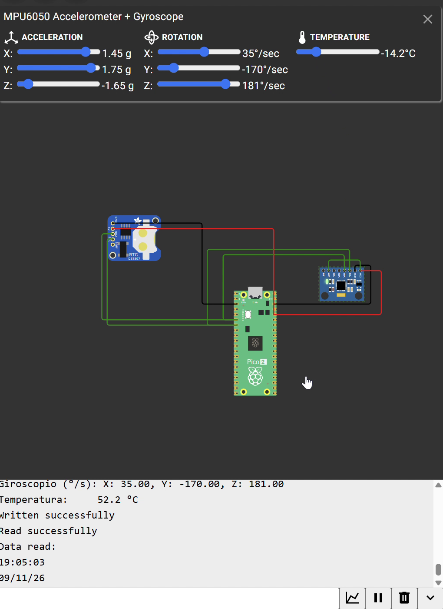

# I2C — Reading a DS1307 RTC and an MPU6050 on the Same Bus (Wokwi)

## Objective

Read two I2C devices on the same bus of the Pico 2: a DS1307 RTC (time and date) and an MPU6050 (acceleration, gyroscope and temperature). Simulated in Wokwi.

## Materials (Wokwi)

- Raspberry Pi Pico 2
- DS1307 RTC module
- MPU6050 module
- Wires for SDA, SCL, power and GND

## Circuit Diagram

```
Pico GPIO4 (I2C0 SDA) → DS1307 SDA  and  MPU6050 SDA
Pico GPIO5 (I2C0 SCL) → DS1307 SCL  and  MPU6050 SCL
Pico 3V3              → DS1307 VCC  and  MPU6050 VCC
Pico GND              → DS1307 GND  and  MPU6050 GND
MPU6050 AD0           → 3V3   (changes its address to 0x69)
```


/// caption
DS1307 and MPU6050 on the same I2C bus in Wokwi
///

- I2C only uses 2 lines for any number of devices: **SDA** (data) and **SCL** (clock, generated by the Pico).
- They're open-drain, so they need pull-ups. Wokwi's modules already have them; on a real circuit I'd use 4.7 kΩ to 3.3 V.

## Source Code

```c
#define RTC_ADDR 0x68   // DS1307 (fixed)
#define MPU_ADDR 0x69   // MPU6050 with AD0 = 1, so it doesn't collide with the RTC
...
// START + addr|W + reg 0x3B, no STOP → REPEATED START + addr|R + 14 bytes + NACK + STOP
int w2 = i2c_write_blocking(I2C_PORT, MPU_ADDR, &regmpu, 1, /*nostop=*/true);
if (w2 < 0) { printf("I2C error (ret=%d)\n", w2); goto next2; }
int r2 = i2c_read_blocking(I2C_PORT, MPU_ADDR, memory2, sizeof(memory2), /*nostop=*/false);
...
int16_t accel_y_raw = (memory2[2] << 8) | memory2[3];   // big-endian: high byte first
int16_t temp_raw    = (memory2[6] << 8) | memory2[7];
float accel_y     = accel_y_raw / 16384.0;              // ±2 g
float temperatura = (temp_raw / 340.0) + 36.53;         // datasheet formula
...
// RTC registers are BCD, so %02X prints them as decimal digits
printf("%02X:%02X:%02X \n", memory[2], memory[1], memory[0]);
```

## How it works

### Addresses

Both chips use **0x68** by default. The DS1307 can't change its address, but the MPU6050 can with the `AD0` pin:

| Device | Address | Why |
|---|---|---|
| DS1307 | `0x68` | Fixed |
| MPU6050 | `0x69` | `AD0` = 1 |

If both had the same address they'd answer at the same time and the data on SDA would get corrupted.

### Reading a register (repeated start)

```
START → addr+W → register → REPEATED START → addr+R → bytes (ACK) → last byte (NACK) → STOP
```

1. `i2c_write_blocking(..., true)`: sends the register number **without STOP**, so the Pico keeps the bus.
2. `i2c_read_blocking(..., false)`: repeated start, reads N bytes (the device auto-increments the register) and ends with STOP.

If the device doesn't answer, the functions return a negative value. That's why I check `w2 < 0`.

### Decoding the MPU6050

From `0x3B` it returns 14 bytes: accel X/Y/Z, temperature, gyro X/Y/Z (2 bytes each).

- Each value is a signed 16-bit number, **big-endian** → `(high << 8) | low` stored in an `int16_t` to keep the sign.
- Conversions (default ranges):

| Quantity | Range | Conversion |
|---|---|---|
| Acceleration | ±2 g | `raw / 16384.0` |
| Gyroscope | ±250 °/s | `raw / 131.0` |
| Temperature | — | `raw / 340.0 + 36.53` |

### Decoding the DS1307

- The time is stored in **BCD**: each nibble is one decimal digit (35 s = `0x35`).
- That's why `%02X` prints the time directly. To do math with it I'd need to convert: `(bcd >> 4) * 10 + (bcd & 0x0F)`.
- Bit 7 of the seconds register is **CH (Clock Halt)**. Writing the time with CH = 0 starts the clock.

## Results

- The RTC was written ("Written successfully") and read back: `19:05:03`, `09/11/26`.
- The MPU6050 follows the sliders in Wokwi: gyro `X: 35.00, Y: -170.00, Z: 181.00`, the same values I set in the simulator.
- Neither device interfered with the other, so the `AD0` change worked.

### Video

<video controls width="640" height="360">
  <source src="../i2c_wokwi_demo.mp4" type="video/mp4">
</video>

## What I learned

- Many devices can share the I2C bus as long as each one has a different address. `AD0` fixed the 0x68 conflict.
- Reading a register = write without STOP + repeated-start read, and I always check the return value.
- Each device decodes differently: the MPU6050 uses signed big-endian values with datasheet scale factors, and the DS1307 uses BCD.
- Wokwi made it easy to check, because I could compare the sliders against the program output.