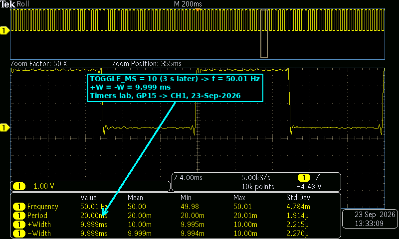

# Timers — Repeating Timer on GP15 (Predict vs Measure)

## Objective

Generate a square wave on GP15 using an SDK repeating timer, with no `sleep_ms()` in the main loop. Then predict its period, frequency and duty cycle from `TOGGLE_MS` and check the prediction on the oscilloscope. The test was done with two values, `TOGGLE_MS = 250` and `TOGGLE_MS = 10`, changing nothing else between runs.

## Materials and Components

- 1 × Raspberry Pi Pico 2 W
- 1 × Digital oscilloscope (Tektronix) with one probe
- Micro-USB cable (programming and power)

No external components: the probe goes directly to the Pico's pins.

## Circuit Diagram

```
GP15 → Oscilloscope CH1 (probe tip)   (timer output)
GND  → Oscilloscope probe ground clip (Pico GND pin only)
```

GP14 was planned as a second channel (CH2) to mark when the callback runs, but it wasn't used in these captures. No photo of the setup was taken in this session.

**Configuration:** default 150 MHz `clk_sys`, timer at its default 1 µs tick, no pull-ups or pull-downs. Oscilloscope at 5 kS/s, 10k points, trigger on the CH1 rising edge.

## Source Code

Key parts of the program, based on the course's repeating-timer example:

```c
#define OUT_PIN    15
#define TOGGLE_MS  250          // only line changed between runs (250 → 10)

static bool toggle_cb(repeating_timer_t *t) {
    level = !level;
    gpio_put(OUT_PIN, level);   // short callback, no sleeps
    return true;                // keep repeating
}

int main(void) {
    ...
    repeating_timer_t timer;
    // negative delay: start-to-start scheduling → jitter but no drift
    add_repeating_timer_ms(-TOGGLE_MS, toggle_cb, NULL, &timer);
    while (true) tight_loop_contents();   // main() is free
}
```

## How it works

`add_repeating_timer_ms()` registers `toggle_cb` so the SDK calls it every `TOGGLE_MS` milliseconds from a hardware timer interrupt. The callback only inverts `level` and writes it to GP15 with `gpio_put()`, so it runs in a few microseconds. Returning `true` tells the SDK to keep repeating it. Since all the timing is done by the timer hardware, `main()` doesn't have to wait on anything: it just stays in `tight_loop_contents()` and could be doing other work.

### Prediction

Each callback changes the pin once, so one full period is one HIGH followed by one LOW, each lasting `TOGGLE_MS`:

```
T    = 2 · TOGGLE_MS
f    = 1 / T = 1000 / (2 · TOGGLE_MS)  Hz
duty = 50 %   (HIGH and LOW both last TOGGLE_MS)
```

| TOGGLE_MS | HIGH = LOW | Period T | Frequency f |
|-----------|------------|----------|-------------|
| 250 ms | 250 ms | 500 ms | 2.000 Hz |
| 10 ms | 10 ms | 20 ms | 50.00 Hz |

### Why the delay is negative

The sign of the delay changes how the SDK schedules each call:

- **Positive delay (`TOGGLE_MS`):** the next call is scheduled `TOGGLE_MS` after the previous callback *finishes*. The callback's own run time and the interrupt latency are added every cycle, so the error accumulates and the signal slowly **drifts**.
- **Negative delay (`-TOGGLE_MS`):** the next call is scheduled `TOGGLE_MS` after the previous one was *supposed to start*, so each deadline is the previous deadline + `TOGGLE_MS`. Interrupt latency still shifts each edge by a few µs, but that error doesn't accumulate: it shows up as **jitter**, not drift.

Because of this, I expected the measured period to match the prediction with only a few µs of jitter per edge.

### Procedure

1. Set `OUT_PIN = 15`, `TOGGLE_MS = 250` and `add_repeating_timer_ms(-TOGGLE_MS, …)`.
2. Built and flashed, then probed GP15 on CH1 at 200 ms/div with Frequency, Period, +Width and −Width measurements → **E1**.
3. Changed only `TOGGLE_MS` to 10, rebuilt and flashed.
4. Zoomed 50× (4 ms/div) on the 200 ms/div record → **E2**.
5. Saved a second capture 3 s later to check repeatability → **E3**.

## Results

| # | Capture | What it shows | Measured values |
|---|---------|---------------|-----------------|
| E1 | `timers_scope1.png` | `TOGGLE_MS = 250`, four full periods at 200 ms/div | f = 2.000 Hz, T = 500.0 ms, +W = 250.0 ms, −W = 250.0 ms |
| E2 | `timers_scope2.png` | `TOGGLE_MS = 10`, 50× zoom (4 ms/div) | f = 50.00 Hz, T = 20.00 ms, +W = 10.00 ms, −W = 9.995 ms, σ(T) = 1.939 µs |
| E3 | `timers_scope3.png` | Same as E2, captured 3 s later | f = 50.01 Hz, T = 20.00 ms, +W = 9.999 ms, −W = 9.999 ms, σ(T) = 1.914 µs |


/// caption
E1 — TOGGLE_MS = 250 ms: 2 Hz, 50 % duty
///


/// caption
E2 — TOGGLE_MS = 10 ms: 50 Hz, zoom 50×
///


/// caption
E3 — TOGGLE_MS = 10 ms, captura 3 s después
///

### Predicted vs measured

| Quantity | Predicted | Measured | Error | Why the difference |
|----------|-----------|----------|-------|--------------------|
| Period, `TOGGLE_MS = 250` | 500 ms | 500.0 ms (E1) | 0.00 % | The real error is µs-level; the 4-digit readout only resolves 0.1 ms |
| Frequency, `TOGGLE_MS = 250` | 2.000 Hz | 2.000 Hz (E1) | 0.00 % | Same as above |
| HIGH / LOW, `TOGGLE_MS = 250` | 250 / 250 ms | 250.0 / 250.0 ms (E1) | 0.00 % | 50 % duty, as expected from a toggle |
| Period, `TOGGLE_MS = 10` | 20 ms | 20.00 ms (E2, E3) | 0.00 % | σ ≈ 1.9 µs is interrupt-latency jitter, well below the 10 µs display step |
| Frequency, `TOGGLE_MS = 10` | 50.00 Hz | 50.00 Hz (E2) / 50.01 Hz (E3) | 0.00 % / +0.02 % | Last-digit variation between captures (jitter + scope rounding) |
| LOW time, `TOGGLE_MS = 10` | 10 ms | 9.995 ms (E2) / 9.999 ms (E3) | −0.05 % / −0.01 % | At 5 kS/s there are 200 µs between samples; the edge position is interpolated, so a few µs of jitter shows up |

`T = 2 · TOGGLE_MS` and `f = 1 / (2 · TOGGLE_MS)` held for both values. The output is a clean 50 % square wave, and changing `TOGGLE_MS` is the only thing needed to change the frequency.

### What went wrong

**Readings that looked "too perfect".** We expected the callback and interrupt overhead to show up as something like 500.12 ms or 501 ms, but E1 reads exactly 500.0 ms and E2 exactly 20.00 ms. At first we thought the scope was "correcting" the value. Looking at the numbers again, we found three reasons:

- The readout only has 4 digits. At 500.0 ms the smallest step is 100 µs, and at 20.00 ms it's 10 µs, so anything smaller is rounded away.
- The scope samples at 5 kS/s, which is 200 µs between samples (marked in E2). A shift of a few µs on an edge can't be seen at that resolution.
- The actual error really is tiny. With `-TOGGLE_MS`, each deadline is the previous deadline + `TOGGLE_MS`, so the interrupt latency (a few µs at 150 MHz) causes jitter but doesn't accumulate into drift. The only place it shows is the Std Dev column: σ(T) ≈ 1.9 µs in E2 and E3.

*Fix for next time:* use a much faster timebase around a single edge (1–10 µs/div, at least 1 MS/s) and read the Std Dev or Min/Max columns instead of Value.

**Polluted statistics in E1.** The Mean, Min and Max columns in E1 show values that are impossible for a 2 Hz signal: a minimum period of 2.4 ms, a maximum frequency of 416.7 Hz and a mean of 14.55 Hz. Those come from samples taken before the signal was stable, while the probe was being connected or the previous program was still running, and the statistics were never reset. For E1 we only trusted the Value column (marked in the capture).

*Fix for next time:* press **Reset Statistics** once the signal has settled.

## Conclusions

This activity showed that a repeating timer can generate a precise periodic signal without blocking the CPU: the timer hardware triggers the callback, and `main()` stays free. The predictions `T = 2 · TOGGLE_MS` and `f = 1 / (2 · TOGGLE_MS)` matched the oscilloscope for both 250 ms and 10 ms, with errors of at most 0.05 %. The most important detail was using a **negative** delay: it schedules each call from the previous deadline instead of from when the callback finished, so interrupt latency only causes jitter (σ ≈ 1.9 µs) and never accumulates as drift.

The measurements also taught something about the instrument itself. A reading that looks "perfect" doesn't mean there's no error; it can mean the error is smaller than the scope's resolution at that timebase and sample rate. Seeing µs-level effects requires zooming in on a single edge and reading the statistics columns, and those statistics only mean something once they've been reset after the signal is stable.