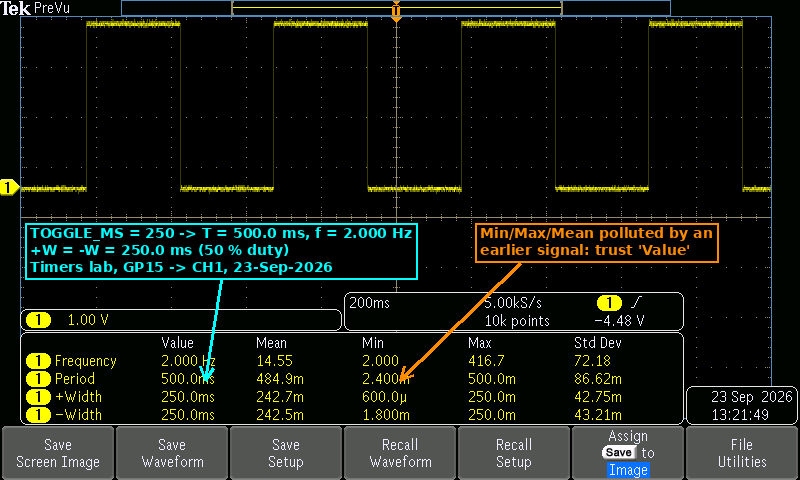
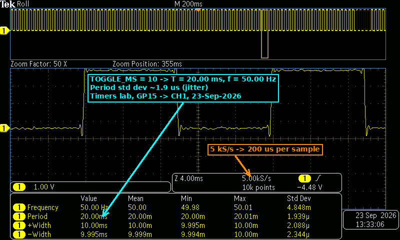

# Timers — Repeating Timer on GP15 (Predict vs Measure)

## Objective

Generate a square wave on GP15 with a repeating timer (no `sleep_ms()`), predict its period, frequency and duty cycle, and check them on the oscilloscope with `TOGGLE_MS = 250` and `TOGGLE_MS = 10`.

## Materials

- Raspberry Pi Pico 2 W
- Tektronix oscilloscope with one probe
- Micro-USB cable

## Circuit Diagram

```
GP15 → Oscilloscope CH1 (probe tip)
GND  → Probe ground clip
```

**Configuration:** `clk_sys` at 150 MHz (default), timer tick of 1 µs. Scope at 5 kS/s, 10k points, trigger on the CH1 rising edge.

## Source Code

```c
#define OUT_PIN    15
#define TOGGLE_MS  250          // only line changed between runs (250 → 10)

static bool toggle_cb(repeating_timer_t *t) {
    level = !level;
    gpio_put(OUT_PIN, level);   // short callback, no sleeps
    return true;                // keep repeating
}

int main(void) {
    ...
    repeating_timer_t timer;
    // negative delay: start-to-start scheduling → jitter but no drift
    add_repeating_timer_ms(-TOGGLE_MS, toggle_cb, NULL, &timer);
    while (true) tight_loop_contents();   // main() is free
}
```

## How it works

- `add_repeating_timer_ms()` makes the hardware timer call `toggle_cb` every `TOGGLE_MS` through an interrupt.
- The callback only toggles GP15 and returns `true` to keep repeating.
- `main()` doesn't wait on anything, so the CPU is free for other work.

### Prediction

Each callback changes the pin once, so one period = one HIGH + one LOW:

```
T    = 2 · TOGGLE_MS
f    = 1000 / (2 · TOGGLE_MS)  Hz
duty = 50 %
```

| TOGGLE_MS | HIGH = LOW | T | f |
|---|---|---|---|
| 250 ms | 250 ms | 500 ms | 2.000 Hz |
| 10 ms | 10 ms | 20 ms | 50.00 Hz |

### Why the delay is negative

- **Positive:** the next call is counted from when the callback *ends*, so the latency adds up every cycle → **drift**.
- **Negative:** the next call is counted from when the previous one *should have started* → the latency doesn't add up, it only shows as **jitter** (a few µs).

### Procedure

1. `TOGGLE_MS = 250`, measured at 200 ms/div → **E1**.
2. Changed only `TOGGLE_MS` to 10, zoomed 50× (4 ms/div) → **E2**.
3. Another capture 3 s later to check repeatability → **E3**.

## Results

| # | TOGGLE_MS | f | T | +W | −W | σ(T) |
|---|---|---|---|---|---|---|
| E1 | 250 | 2.000 Hz | 500.0 ms | 250.0 ms | 250.0 ms | — |
| E2 | 10 | 50.00 Hz | 20.00 ms | 10.00 ms | 9.995 ms | 1.939 µs |
| E3 | 10 | 50.01 Hz | 20.00 ms | 9.999 ms | 9.999 ms | 1.914 µs |


/// caption
E1 — TOGGLE_MS = 250 ms: 2 Hz, 50 % duty
///


/// caption
E2 — TOGGLE_MS = 10 ms: 50 Hz, 50× zoom
///


/// caption
E3 — TOGGLE_MS = 10 ms, 3 s later
///

### Predicted vs measured

| Quantity | Predicted | Measured | Error |
|---|---|---|---|
| T (250) | 500 ms | 500.0 ms | 0.00 % |
| f (250) | 2.000 Hz | 2.000 Hz | 0.00 % |
| HIGH / LOW (250) | 250 / 250 ms | 250.0 / 250.0 ms | 0.00 % |
| T (10) | 20 ms | 20.00 ms | 0.00 % |
| f (10) | 50.00 Hz | 50.00 / 50.01 Hz | 0.00 / +0.02 % |
| LOW (10) | 10 ms | 9.995 / 9.999 ms | −0.05 / −0.01 % |

The prediction held for both values: a clean 50 % square wave, and only `TOGGLE_MS` needs to change to change the frequency.

### What went wrong

**Readings that looked "too perfect."** I expected something like 500.12 ms because of the interrupt latency, but I got exactly 500.0 ms. The reasons:

- The readout has 4 digits: at 500.0 ms the smallest step is 100 µs, and at 20.00 ms it's 10 µs.
- At 5 kS/s there are 200 µs between samples, so a few µs can't be seen.
- The real error is tiny thanks to the negative delay. It only shows up in σ(T) ≈ 1.9 µs.

*Next time:* zoom in on a single edge (1–10 µs/div, ≥ 1 MS/s) and read Std Dev or Min/Max.

**Bad statistics in E1.** Mean, Min and Max showed impossible values for 2 Hz (e.g. a 2.4 ms minimum period). They came from samples taken before the signal was stable, and I never reset the statistics. For E1 I only used the Value column.

*Next time:* press **Reset Statistics** once the signal is stable.

## What I learned

- A repeating timer generates a precise signal without blocking the CPU.
- `T = 2 · TOGGLE_MS` matched the scope with ≤ 0.05 % error.
- The negative delay is key: the latency turns into jitter (σ ≈ 1.9 µs), not drift.
- A "perfect" reading doesn't mean there's no error. It can mean the error is below what the scope can resolve with that setup.