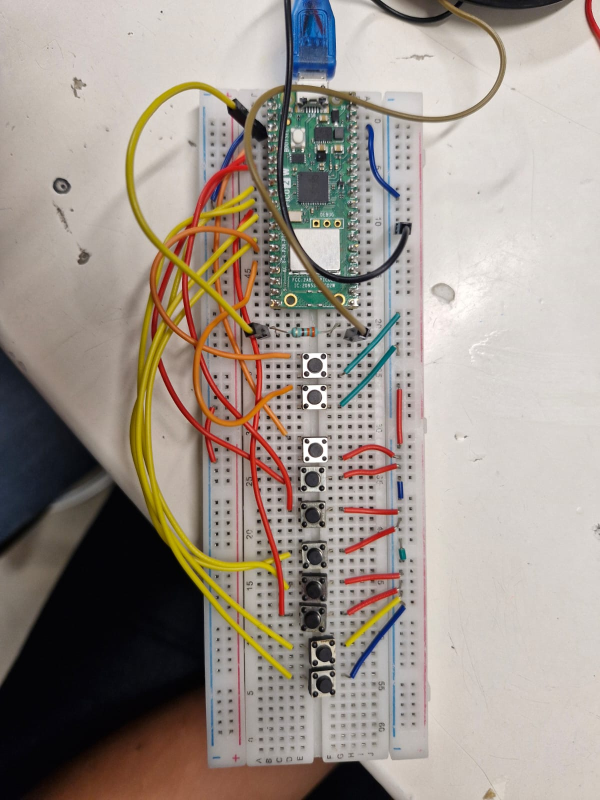

# Digital Piano with PWM (RP2350)

## Objective

Build an 8-key piano (one octave, Do to Do) with a buzzer and PWM. Each key plays its note while held, and two buttons raise or lower the volume by changing the duty cycle.

## Materials

- Raspberry Pi Pico 2 W
- Passive buzzer (it has to be passive so it follows the PWM frequency)
- 10 push-buttons (8 keys + 2 volume)
- Protoboard, jumper wires, micro-USB cable

## Circuit Diagram

```
GPIO2  → Buzzer (+) ; Buzzer (−) → GND

GPIO3  → Key Do  → GND
GPIO4  → Key Re  → GND
GPIO5  → Key Mi  → GND
GPIO6  → Key Fa  → GND
GPIO7  → Key Sol → GND
GPIO8  → Key La  → GND
GPIO9  → Key Si  → GND
GPIO10 → Key Do (high) → GND

GPIO11 → Volume up   → GND
GPIO12 → Volume down → GND

(All buttons use the internal pull-up)
```


/// caption
Digital piano connection diagram
///

With the pull-up, a button reads `1` when released and `0` when pressed, so I check for `gpio_get(pin) == 0`.

## Source Code

```c
#include <stdio.h>
#include "pico/stdlib.h"
#include "hardware/pwm.h"

#define BUZZER 2          
#define TOP 1023          
#define PRIMERA_TECLA 3   
#define BTN_SUBIR 11      
#define BTN_BAJAR 12     


int notas[8] = {
    1046, // Do
    1175, // Re
    1318, // Mi
    1397, // Fa
    1568, // Sol
    1760, // La
    1975, // Si
    2093  // Do 
};

int main() {
    stdio_init_all();   

    //buzzer
    gpio_set_function(BUZZER, GPIO_FUNC_PWM);       
    uint slice = pwm_gpio_to_slice_num(BUZZER);    
    uint canal = pwm_gpio_to_channel(BUZZER);      
    pwm_set_wrap(slice, TOP);                       
    pwm_set_chan_level(slice, canal, 0);            
    pwm_set_enabled(slice, true);                   

    //teclas
    for (int pin = 3; pin <= 12; pin++) {
        gpio_init(pin);             
        gpio_set_dir(pin, GPIO_IN);  
        gpio_pull_up(pin);           
    }

    int volumen = 256;   

    while (true) {   

        // volumen+
        if (gpio_get(BTN_SUBIR) == 0) {          
            volumen = volumen + 64;              
            if (volumen > 512) volumen = 512;    
            printf("Volumen: %d\n", volumen);
            sleep_ms(50);                        
            while (gpio_get(BTN_SUBIR) == 0) {}  
            sleep_ms(50);                       
        }

        // volumen-
        if (gpio_get(BTN_BAJAR) == 0) {          
            volumen = volumen - 64;              
            if (volumen < 0) volumen = 0;
            printf("Volumen: %d\n", volumen);
            sleep_ms(50);
            while (gpio_get(BTN_BAJAR) == 0) {}
            sleep_ms(50);
        }

        // tecla presionada
        int tecla = -1;   
        for (int i = 0; i < 8; i++) {                  
            if (gpio_get(PRIMERA_TECLA + i) == 0) {    
                tecla = i;                             
                break;                                 
            }
        }

        
        if (tecla == -1) {
            pwm_set_chan_level(slice, canal, 0);       
        } else {

            // divisor = reloj del pico / (nota * 1024)
            float divisor = 150000000.0f / (notas[tecla] * (TOP + 1));
            pwm_set_clkdiv(slice, divisor);            
            pwm_set_chan_level(slice, canal, volumen); 
        }

        sleep_ms(10);   
    }
}
```

## How it works

### Pitch → clock divider

The PWM counter goes from 0 to `TOP` (1023), so one period is 1024 counts. With the 150 MHz clock:

```
f_out = 150 000 000 / (divisor × 1024)   →   divisor = 150 000 000 / (f_note × 1024)
```

| Key | Note | f (Hz) | Divider |
|---|---|---|---|
| GPIO3  | Do  | 1046 | 140.04 |
| GPIO4  | Re  | 1175 | 124.67 |
| GPIO5  | Mi  | 1318 | 111.14 |
| GPIO6  | Fa  | 1397 | 104.86 |
| GPIO7  | Sol | 1568 | 93.42  |
| GPIO8  | La  | 1760 | 83.23  |
| GPIO9  | Si  | 1975 | 74.17  |
| GPIO10 | Do  | 2093 | 69.99  |

All the dividers are inside the valid range (1–256), which is why this octave works with `TOP = 1023`.

### Volume → duty cycle

- Duty = `volumen / 1024`. It starts at 256 (25 %) and moves in steps of 64, between 0 and 512.
- The max is 50 % because that's the loudest a square wave gets on the buzzer. Going higher makes it quieter again.

### Main loop (polling)

- Volume buttons: `sleep_ms(50)` → wait until released → `sleep_ms(50)`, so one press = one change (debounce).
- It scans the keys from GPIO3 up and keeps the first one pressed.
- No key → level 0 (silence). Key pressed → set its divider and the volume.

## Results

- Each key plays its note while held and stops when released.
- The volume changes in noticeable steps and is printed on the serial monitor.
- With two keys pressed at the same time only the lower one sounds, because the scan stops at the first one.

### Video

<video controls width="640" height="360">
  <source src="../piano.mp4" type="video/mp4">
</video>

## What I learned

- PWM also works as a tone generator: the divider sets the frequency and the duty cycle sets the volume.
- With `f = f_clk / (divisor × (TOP + 1))` I could calculate each note's exact divider instead of guessing.
- Polling works fine here because the loop only takes 10 ms.
- Limitations: it's monophonic (one PWM slice → no chords), and while a volume button is held the `while` blocks the keys. Using interrupts for those buttons, like in the roulette lab, would fix that.